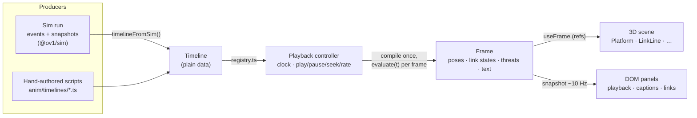

# Animation layer

How things move in the OV-1. Read this before you animate anything. Then read:

- **[authoring.md](authoring.md)**: write a timeline for a scenario, step by step, with a reference for every primitive.
- **[extending.md](extending.md)**: add a new channel, bind a new scene element, or wire the sim in.
- **[ADR-0006](../adr/0006-animation-timeline.md)**: why it's built this way.

Code: `apps/web/src/anim/`. Public API: `import { … } from "../anim"`.

---

## The idea in one paragraph

Everything that changes over time in the scene is described by a **Timeline**: plain data saying
where each actor goes, what state each link is in, which threats are active, and what text to show,
all as a function of playback time. An **interpreter** turns a Timeline into a **Frame** for any time
`t`. That's a pure function, so play, pause, scrub, loop, speed, and replay all come from one
mechanism. Scene components never animate themselves. They read the current Frame and draw it.



## Pieces

| File | Role |
|---|---|
| `anim/types.ts` | **The format.** `Timeline`, `ActorTrack`, `MotionSegment`, `LinkKey`, `ThreatKey`, `Cue`, `Pose`, `Frame`. |
| `anim/compile.ts` | Resolves places, chains segments end to start, precomputes curves. Runs once per load. |
| `anim/evaluate.ts` | `evaluate(compiled, t) → Frame`. Pure. Derives heading, bank, and pitch from motion. |
| `anim/validate.ts` | Checks a Timeline against the catalog (IDs, link states, timing, loop seams, jumps). |
| `anim/playback.ts` | The clock: `load / play / pause / toggle / seek / restart / setRate / tick`. Framework-free. |
| `anim/instance.ts` | The app's single `playback` controller. Starts on the idle timeline. |
| `anim/react.tsx` | `<AnimationDriver/>` (ticks the clock inside `<Canvas>`), `useActorTransform(nodeId)`, `usePlayback(selector)`. |
| `anim/space.ts` | `homePosition`, `resolvePlace`, `livePosition(frame, id)`, `linkStateOf(frame, link)`. |
| `anim/roles.ts` | Catalog lookups so scripts never hardcode IDs: `nodeIdOfKind`, `linkIdsTouching`, `scenarioTargets`. |
| `anim/fromSim.ts` | `timelineFromSim()`: sim event log + position samples → Timeline. |
| `anim/timelines/registry.ts` | **The one wiring point.** `IDLE_TIMELINE`, `MISSION_TIMELINES`, `SCENARIO_TIMELINES`, `DEV_TIMELINES`. |
| `anim/timelines/refuel-op.ts` | Baseline mission: the 18-step refuel op (tanker + receiver formation), with `steps`. |
| `anim/timelines/idle.ts` | The default timeline: the UAV flies a holding orbit, "LOITER · AWAITING TASKING". |
| `anim/timelines/reference.ts` | Dev-only demo that exercises every primitive and channel. Copy its patterns. |
| `panels/PlaybackControls.tsx` | Timeline picker, play/pause, restart, speed, scrubber, `T+mm:ss.s` clock. |
| `panels/ScenarioList.tsx` | Clicking a scenario plays its registered timeline. Clicking it again returns to idle. |
| `components/CaptionOverlay.tsx` | Caption cues, top of the viewport. |
| `panels/MissionSteps.tsx` | The playing timeline's written procedure. Active step highlighted; click / Prev / Next seek. |

## Channels a Timeline can drive

| Channel | Authored as | Read in the scene as | Rendered today by |
|---|---|---|---|
| Actor motion | `actors[nodeId].segments` | `frame.actors.get(id)` / `livePosition()` | `Platform` (position + attitude), `LinkLine` (endpoints and label follow) |
| Link state | `links[linkId]: LinkKey[]` | `linkStateOf(frame, link)` / `snapshot.discrete.links` | Links panel text. **Line patterns:** `link-state-render` task |
| Threat active | `threats[threatId]: ThreatKey[]` | `frame.activeThreats` / `snapshot.discrete.activeThreats` | Nothing yet. **Volumes:** `threat-volumes` task |
| Caption | `cues: {kind:"caption"}` | `snapshot.discrete.captions` | `CaptionOverlay` |
| Node status | `cues: {kind:"status"}` | `snapshot.discrete.status` | Second line of the node's callout |
| Mission step | `steps: MissionStep[]` | `frame.stepIndex` / `snapshot.discrete.stepIndex` | `panels/MissionSteps.tsx` (right panel) |

## Rules (in addition to AGENTS.md)

1. **Who decides what the UAV does.** SPEC §1 says the animation and the numbers come from the same
   engine. Once `sim-runner` lands, *behavior under attack* (lost-link RTB, nav drift, crash) comes from
   the sim through `timelineFromSim()`, not from a hand-written script. Hand-authored timelines are for
   idle and ambient motion, presentation choreography (captions, status text, staging), and **clearly
   labeled storyboards** used as placeholders until the sim produces the run. Never tune a script to
   "look like" a result the sim hasn't produced.
2. **Timelines are data.** No functions, no `Math.random`, no wall-clock reads inside a timeline.
   The same Timeline and the same `t` always give the same Frame.
3. **No hardcoded IDs.** Get node, link, and threat IDs from `roles.ts` helpers or catalog relationships
   (`scenario.threats → threat.targets.links`). The registry key is the only place a scenario ID is
   written out, and its test checks it.
4. **No per-frame React state.** Anything that moves reads `playback.frame` inside `useFrame` and
   writes to refs. React state (`usePlayback`) is only for things that change discretely.
5. **Diorama units, not meters.** Timelines live in the compressed render space of `scene/layout.ts`.
   Map sim SI positions to diorama space *before* building a Timeline.
6. **Colors still come from tokens.** The animation layer never picks colors. Rendering components do,
   from `theme/tokens.css`, following SPEC §8 (red is only for adversary).
7. **Every registered timeline is validated in CI** (`timelines/registry.test.ts`). If validation
   complains, fix the timeline. Don't loosen the validator.

## Conventions

- **Time:** seconds, timeline-local, starting at 0. Looping timelines wrap at `durationS`.
  Non-looping ones stop at the end and the Play button becomes Replay.
- **Heading:** radians about +y. `0` = nose along +x. Positive turns the nose toward −z, which is a
  left turn seen from above. `vec.ts` has `headingVector` / `headingOf`.
- **Bank:** negative = left wing down (left turn). It's derived from the turn rate (`G_VIS` in
  `evaluate.ts`) and capped at 35°. Pitch is derived from the climb rate and capped at 25°.
- **Platform models:** the nose must point along +x and the right wing along +z for derived attitude
  to look right (`platforms.tsx`, `kind: "uav"`).
- **Reduced motion:** if the OS asks for reduced motion, playback starts paused.

## Commands

```bash
pnpm dev                       # http://localhost:5173. Dev builds add REFERENCE to the timeline picker
pnpm --filter @ov1/web test    # interpreter, validator, playback, sim adapter, registry
pnpm test:e2e                  # includes "idle timeline flies the UAV; pause freezes it; scrub seeks"
```
